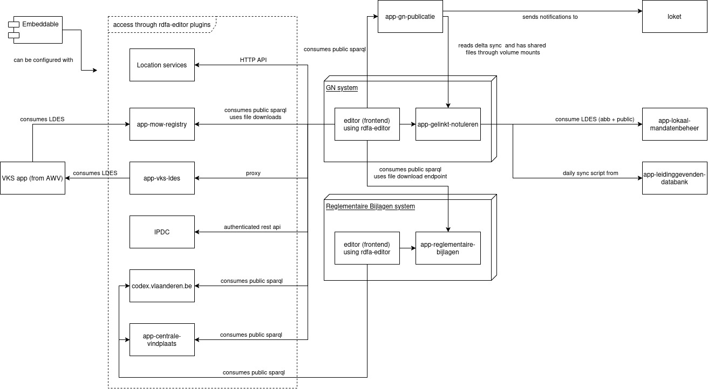

# Systems Diagram

Here is a quick graphical overview of the connections in the GN sphere of influence. This includes other apps than the app-gelinkt-notuleren

# Systems and Components

This section clarifies the components and connections in the diagram above. GN and Reglementaire bijlagen show the editor frontend separately as many of the dependencies originate from the rdfa-editor library or its plugins directly, not through backend services. The content fetched from these dependencies is then also only stored in the RDFa of the contents generated by the editor, not stored in the triplestore directly.

> [!NOTE]
> In this document, mu-authorization as a term is used for a triplestore with mu-authorization capabilities: authorization, delta publication, ... Most, if not all of the apps mentioned here already use the newer 'sparql-parser' implementation, but that is a detail that should not matter in this overview.

## [rdfa-editor](https://github.com/lblod/ember-rdfa-editor)

The rdfa-editor is the star of the GN ecosystem. It's a library that provides RDFa-aware rich text editing based on [prosemirror](https://prosemirror.net/). The editor has [various plugins](https://github.com/lblod/ember-rdfa-editor-lblod-plugins) that allow manipulating data specific to the lblod ecosystem, including interfacing with many linked data depenencies (shown as 'access through rdfa-editor-plugins' on the left of the drawing above).

The rdfa-editor is included in the ember frontends of both the Gelinkt Notuleren and Reglementaire Bijlagen systems. It's called editor in their docker-compose setup. However, it is also bundled as a **[plain typescript library called the 'embeddable'](https://github.com/lblod/frontend-embeddable-notule-editor)**. This library is made so the rdfa-editor can be bundled into any javascript application, not just ember and the intent is that it is used by the vendors. These can use the list of lblod plugins above or make their own.

## GN System

This is the core [GN application](https://github.com/lblod/app-gelinkt-notuleren). Its main goal is to host the [frontend gelinkt notuleren](https://github.com/lblod/frontend-gelinkt-notuleren/) and to store the contents it generates. Like any semantic.works application, it builds on a mu-authorization triplestore to store its data. However it also allows its editor to consume many different datasources directly.

## [app-lokaal-mandatenbeheer](https://github.com/lblod/app-lokaal-mandatenbeheer/)

The GN application consumes the public and abb LDES streams published by the LMB application and loads the instances it finds there into its own triplestore for the following types: mandaat:Mandataris, mandaat:Fractie, org:Membership, person:Person, person:Geboorte. It splits the data into public and private graphs depending on the types. It removes data marked as Tombstones and it stores the last updateTime using ext:lastLMBUpdate based on the timestamp of the versioned URIs in the LDES stream.

## [app-leidinggevenden-databank](https://github.com/lblod/app-leidinggevenden-databank)

A daily [sync script](https://github.com/lblod/app-gelinkt-notuleren/blob/master/automated-sync.sh#L11) is run to fetch the leidinggevenden data from the leidinggevenden database. This is done based on a cronjob. It loads an export out of the leidinggevenden db into a temp graph and then removes the existing data in GN from its own triplestore and loads the data from the export. Some care needs to be taken so it doesn't delete instances of datatypes that are overlapping with other sources. Details are [in this script](https://github.com/lblod/app-gelinkt-notuleren/blob/master/scripts/project/prepare-data-sync-migrations-ldb/run.sh).

## [app-gn-publicatie](https://github.com/lblod/app-gn-publicatie/)

This is the publication platform of GN, providing a frontend and sparql endpoint to expose published resources. It tracks instances of type <http://mu.semte.ch/vocabularies/ext/signing/PublishedResource> and their related data (see the [published-resource-producer service](https://github.com/lblod/published-resource-producer/blob/master/lib/producer.js#L24)) from GN by following a delta stream (only those instances are published there). The files themselves are shared using a mounted volume (both systems exist on the same server). GN consumes the publicatie SPARQL endpoint in the frontend for linking to other decisions in citations.

When publications arrive and are correctly processed, app-gn-publicatie notifies the loket system through its [besluit-publicatie-melding-service](https://github.com/lblod/besluit-publicatie-melding-service)

## [app-mow-registry](https://github.com/lblod/app-mow-registry/)

This is a typical semantic.works application to maintain the list of traffic regulations (e.g. road signs). It publishes an LDES that is used by the VKS application from the Agentschap Wegen en Verkeer (AWV). It has a frontend and a public sparql endpoint.

The GN frontend consumes the public SPARQL endpoint from the mow registry application to get the info regarding traffic signals. It also uses the file downloads provided by this app to fetch the images related to the traffic signals. It includes the resulting uris and snippets into the decisions it creates.

## [app-vks-ldes](https://github.com/lblod/app-vks-ldes)

This is an application that exists to provide (authenticated) API access to the data harvested from the VKS application over LDES. It is used by vendors and by the GN editor. The GN editor uses [a proxy on top of the vendor-login](https://github.com/lblod/app-gelinkt-notuleren/blob/master/docker-compose.yml#L276) stack exposed by this service that only grants access if the user has the proper mu-authorization rights.

## [codex.vlaanderen.be](https://codex.vlaanderen.be)

This is a service of the Kanselarij en Buitenlandse Zaken where users can search through the Flemish regulations starting from january 1 1959. This service also has [a public SPARQL endpoint](https://codex.opendata.api.vlaanderen.be:8888/sparql).

The GN editor uses this endpoint for creating citations (links) to existing regulation on the Flemish level. The reglementaire bijlagen editor does the same thing.

## [app-centrale-vindplaats](https://github.com/lblod/app-centrale-vindplaats)

A central location for exposing all public data of local decisions as linked open data, chiefly through a public SPARQL endpoint, but it also hosts a metis stack to make LBLOD URIs dereferenceable.

The GN and Reglementaire Bijlagen editors use this public SPARQL endpoint to get an up to date list of concepts in the conceptscheme:BesluitType, [limited by certain filters](https://github.com/lblod/ember-rdfa-editor-lblod-plugins/blob/master/addon/plugins/besluit-type-plugin/utils/fetchBesluitTypes.ts#L11)

## Reglementaire Bijlagen System

The [reglementaire bijlagen system](https://github.com/lblod/app-reglementaire-bijlage) is the system that manages the templates for decisions used in the GN system. Like the GN system, it uses the rdfa editor frontend which, itself can directly make use of various sparql sources. The application also allows the management of codelist and template snippets for use in templates.

The GN editor frontend uses the SPARQL endpoint of reglementaire bijlagen to fetch the available templates/snippets as linked data and then fetches the actual template files from its file endpoint.

## IPDC

> [!WARNING]
> Note, the plugin and service are called LPDC, but it is indeed IPDC that is being interfaced with.

The LPDC service is reached through a [plugin from the editor](https://github.com/lblod/frontend-embeddable-notule-editor/blob/master/docs/plugins/lpdc-plugin.md#L1) of both gelinkt notuleren and reglementaire bijlagen. It goes through a [proxy service](https://github.com/lblod/app-gelinkt-notuleren/blob/master/docker-compose.yml#L224) in the apps that only grants access if the user has the proper rights defined in mu-authorization.

It is used to insert IPDC codes into the templates.

## Location Services

The editor has [a locations plugin](https://github.com/lblod/frontend-embeddable-notule-editor/blob/master/docs/plugins/location-plugin.md#L1-L0) to allow adding locations, both from the adressenregister and by point/area using geo.api.vlaanderen.be. Resulting locations are stored in the decision RDFa.
